# Architecture & Flow Diagrams

Diagrams for [ARCHITECTURE.md](ARCHITECTURE.md). All diagrams are Mermaid and
render on GitHub. Test counts are not quoted here. The CI `counts` job writes
them to `counts.json`.

---

## 1. The portfolio at a glance: areas, asset classes, languages

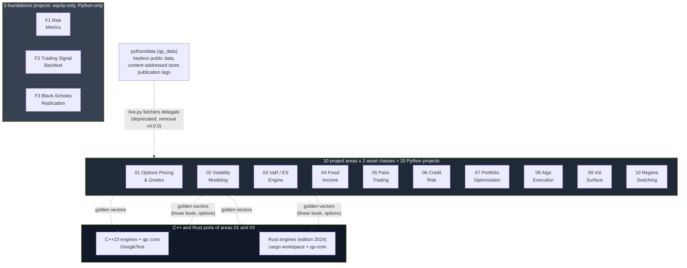

Why only areas 01 and 03 are ported: see [ARCHITECTURE.md](ARCHITECTURE.md)
"The 10 project areas".

---

## 2. Golden-vector pipeline

How a Python-side expected value becomes a test assertion in C++ and Rust.

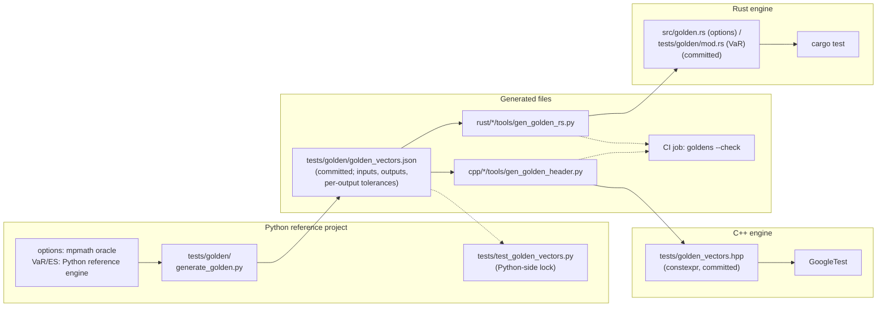

Each options output carries its own tolerance from the JSON's
`tolerance_rules`. VaR/ES values come from the Python engine through the same
generator. Agreement shows the ports compute what Python computes. It does not
show that Python is correct. Each project's analytic-identity and convergence
tests carry that.

---

## 3. Differential-test pipeline (options engines)

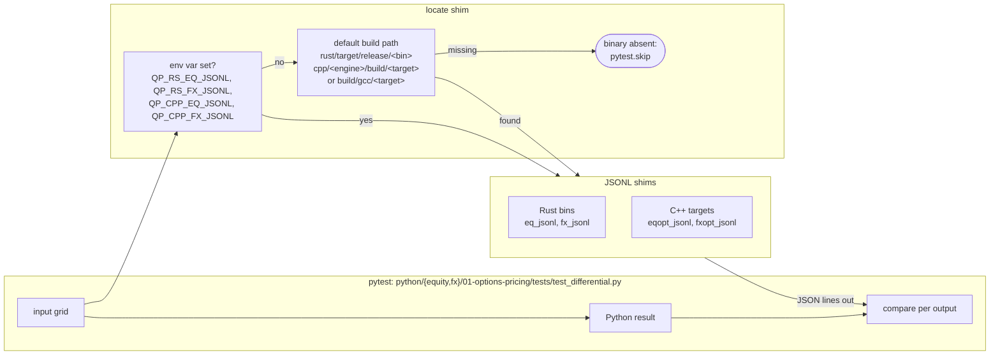

---

## 4. Data flow: Options Pricing & Greeks (area 01)

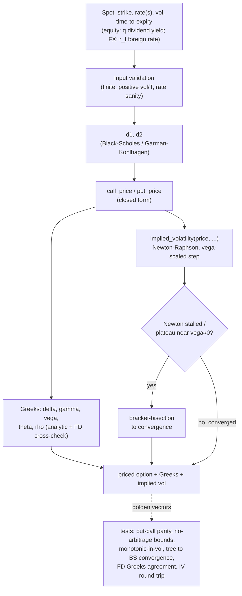

When Newton stops improving, the solver falls through to bisection and runs to
the full tolerance.

---

## 5. Data flow: Market Risk VaR / Expected Shortfall (area 03)

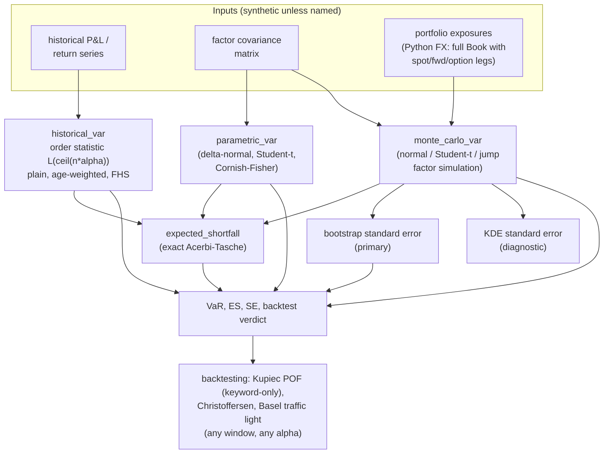

`alpha` is the tail probability in (0, 0.5) everywhere. The C++ and Rust VaR
engines revalue linear books and European options (full repricing per
scenario, vol held fixed).

---

## 6. CI jobs

```mermaid
flowchart TD
    DISC["discover<br/>(list Python projects + test extra)"]
    HASH["hashed_install.sh<br/>uv export from uv.lock,<br/>pip --require-hashes --only-binary,<br/>local packages --no-build-isolation, pip check"]
    PYC["py core<br/>python/core x Python 3.11-3.13"]
    PY["py &lt;project&gt;<br/>per project x Python 3.11-3.13<br/>pytest, JUnit XML"]
    LINT["lint<br/>uv lock --check, constraints = lock,<br/>ruff, mypy"]
    GOLD["goldens --check<br/>gen_golden_header.py / gen_golden_rs.py"]
    CPP["cpp &lt;engine&gt; (&lt;preset&gt;)<br/>gcc, clang, asan, tsan,<br/>gcc16-cxx26, msvc"]
    CORE["cpp core (&lt;preset&gt;)<br/>shared kernels + tests"]
    FMT["clang-format, clang-tidy"]
    RUST["rust &lt;crate&gt;, rust fmt<br/>qp-core + 4 engines<br/>cargo test, clippy -D warnings"]
    BIND["bind &lt;package&gt;<br/>qp-cpp, qp-rust"]
    DIFF["engine differential<br/>both bindings, 10,000-input harness,<br/>no skips allowed"]
    CMI["cmake install (gcc, clang)<br/>install QuantPortfolio,<br/>build find_package consumer<br/>with source tree moved aside"]
    WHL["wheels &lt;package&gt; (&lt;os&gt;)<br/>cibuildwheel cp311-cp313,<br/>manylinux_2_34 + Windows,<br/>artefacts wheels-*"]
    BENCH["bench<br/>base vs head on one runner,<br/>3 alternating rounds, CPU 1;<br/>fail: median +25% AND head p10 &gt; base p90"]
    HYG["hygiene<br/>banned-word check,<br/>voice report (report-only)"]
    RES["research<br/>prereg.py check, research/tests"]
    PYD["py data<br/>python/data x Python 3.11-3.13<br/>recorded responses"]
    LRN["learning<br/>notebook + career-prep tests,<br/>nbmake on solution notebooks"]
    CNT["counts<br/>aggregate executed counts<br/>into counts.json"]
    OK(["ci-ok<br/>required check:<br/>every gated job succeeded"])

    HASH -.->|installs for| PYC & PY & LINT & BIND & DIFF & RES & PYD & LRN
    DISC --> PY
    PY & PYC & CPP & RUST & BIND --> CNT
    DISC & PYC & PY & LINT & GOLD & CPP & CORE & FMT & RUST & BIND & DIFF & CMI & WHL & BENCH & HYG & RES & PYD & LRN & CNT --> OK
```

The `wheels` job is part of `ci-ok`; it joined after its first green run. The bench gate is described in [BENCHMARKS.md](BENCHMARKS.md).

---

## 7. The `engine=` switch

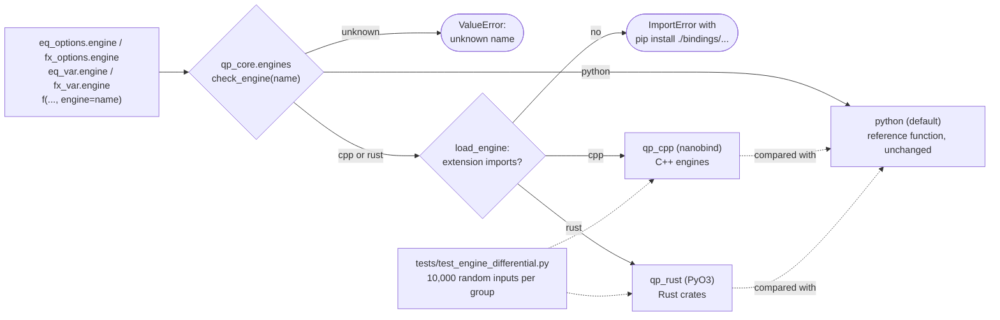

---

## 8. Pre-registration workflow 

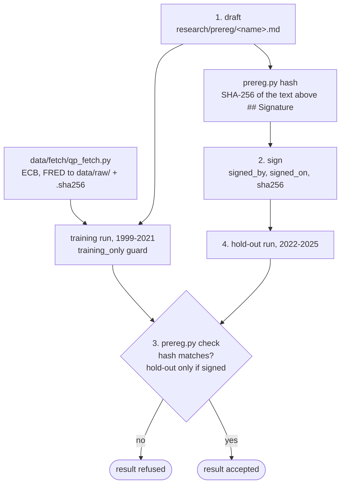

State: `regime-fx-basket` signed and run once on the hold-out (H0 not
rejected); `pairs-fx-g10` signed, then withdrawn before the hold-out
(DR-R4-5); `pairs-fx-g10-v2` and `momentum-fx-g10` signed on 2026-11-02 and
scored once on forward data (2026-11-03 to 2028-11-02, `research/forward/`),
on or after 2028-11-13; the order-book execution study an unsigned draft,
not done because its data needs an account. Equity pairs on a
point-in-time universe are not drafted for the same reason. Diagram 11 shows the whole
life of a study.

---

## 9. Newer model dependencies

```mermaid
flowchart LR
    subgraph RATES["fi_rates (equity/04)"]
        OIS["multicurve<br/>bootstrap_ois"] --> PROJ["multicurve<br/>bootstrap_projection"]
        PROJ --> RO["rate_options<br/>caps, swaptions"]
        OIS --> HW["hull_white<br/>Jamshidian swaptions"]
    end
    subgraph SURF["eq_surface (equity/09)"]
        SSVI["ssvi"] --> DUP["dupire"]
        HES["heston"] --- BAT["bates"]
    end
    subgraph AMER["eq_options: American pricer choice"]
        LR["lr_tree<br/>reference"] -.->|oracle| ALO["alo<br/>fast"]
        LR -.->|oracle| PDE["pde<br/>Crank-Nicolson"]
    end
    subgraph RISK["eq_var / fx_var"]
        REV["revaluation"] --> ATT["risk_attribution"]
        REV --> FRTB["frtb_ima"]
    end
    subgraph CMP["cpp + rust VaR engines"]
        OR["option_reval"] --> OV["historical / MC option VaR"]
    end
    REV -.->|goldens 1e-11| OR
```

---

## 10. Shared kernels and the packages that wrap them

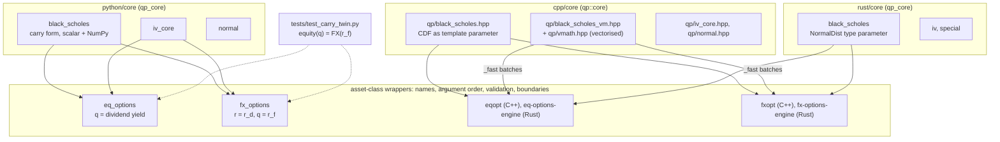

The kernel is Black-Scholes in cost-of-carry form, `b = r - q`: equity
passes its yield, FX passes `r_d` and `r_f`, futures pass `q = r`
(`b = 0`). Moving the maths into the kernel changed no output bit in any
language. The C++ and Rust kernels take the normal CDF as a parameter
because the equity and FX engines use different implementations.

---

## 11. Research lifecycle of one study

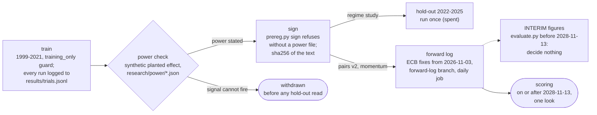

The hold-out was used once, by the regime study, and is spent: later
studies can only be tested on data that did not exist when they were
signed. The forward rule is scored once, so looking at interim numbers
cannot change the outcome.

---

## 12. Desk stacks: from an order to post-trade

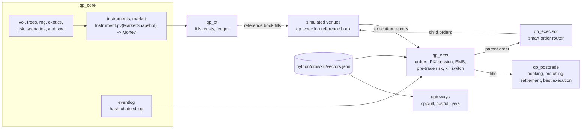

Nothing in this diagram touches a real venue. The kill-switch vectors are
the contract (`docs/KILL_CONTRACT.md`): Python, C++, Rust and Java each
replay them and must produce the same bytes.

Fix history is in [CHANGELOG.md](../CHANGELOG.md).
