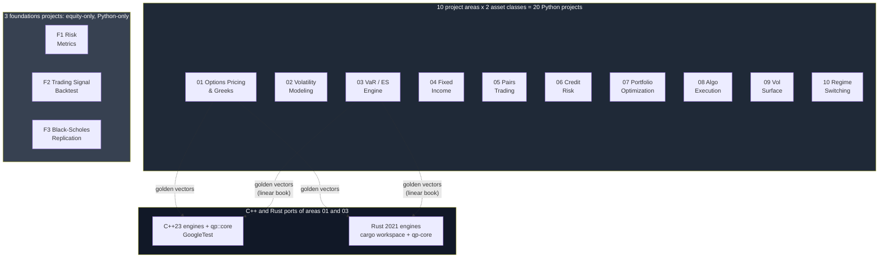
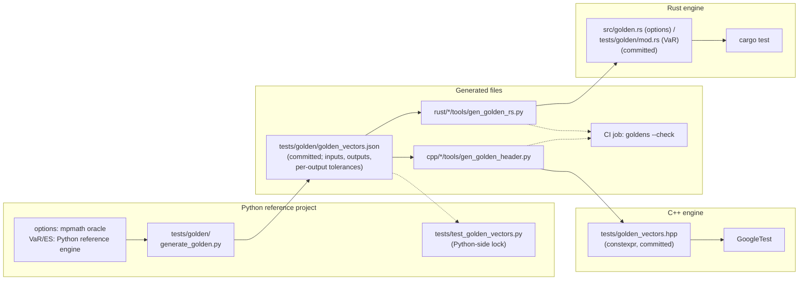
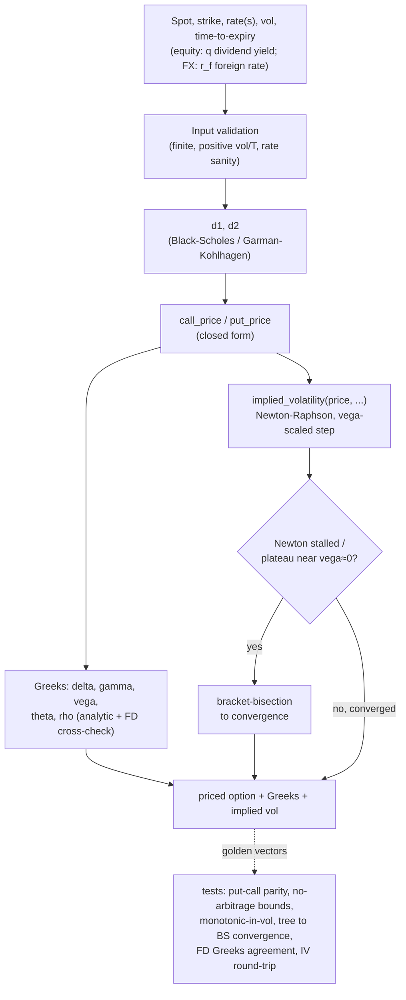
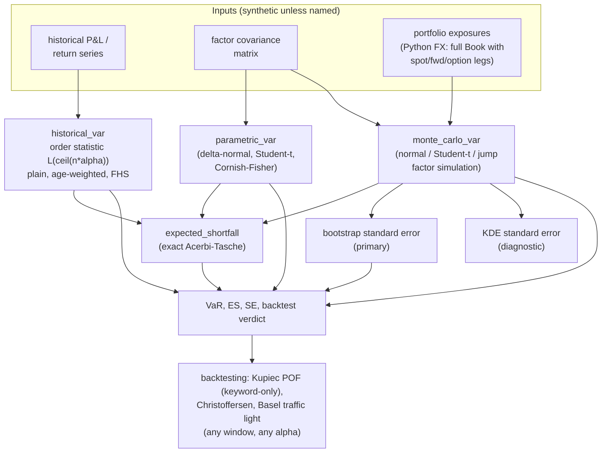
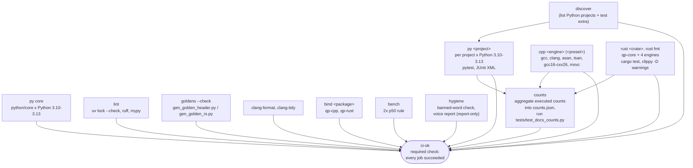

# Architecture & Flow Diagrams

Diagrams for [ARCHITECTURE.md](ARCHITECTURE.md). All diagrams are Mermaid and
render on GitHub. Test counts are not quoted here. The CI `counts` job writes
them to `counts.json`.

---

## 1. The portfolio at a glance: areas, asset classes, languages

Why only areas 01 and 03 are ported: see [ARCHITECTURE.md](ARCHITECTURE.md)
"The 10 project areas".

---

## 2. Golden-vector pipeline

How a Python-side expected value becomes a test assertion in C++ and Rust.

Each options output carries its own tolerance from the JSON's
`tolerance_rules`. VaR/ES values come from the Python engine through the same
generator. Agreement shows the ports compute what Python computes. It does not
show that Python is correct. Each project's analytic-identity and convergence
tests carry that.

---

## 3. Differential-test pipeline (options engines)

---

## 4. Data flow: Options Pricing & Greeks (area 01)

When Newton stops improving, the solver falls through to bisection and runs to
the full tolerance.

---

## 5. Data flow: Market Risk VaR / Expected Shortfall (area 03)

`alpha` is the tail probability in (0, 0.5) everywhere. The C++ and Rust VaR
engines are linear-book ports and do not revalue options.

---

## 6. CI jobs

Fix history is in [CHANGELOG.md](../CHANGELOG.md).
